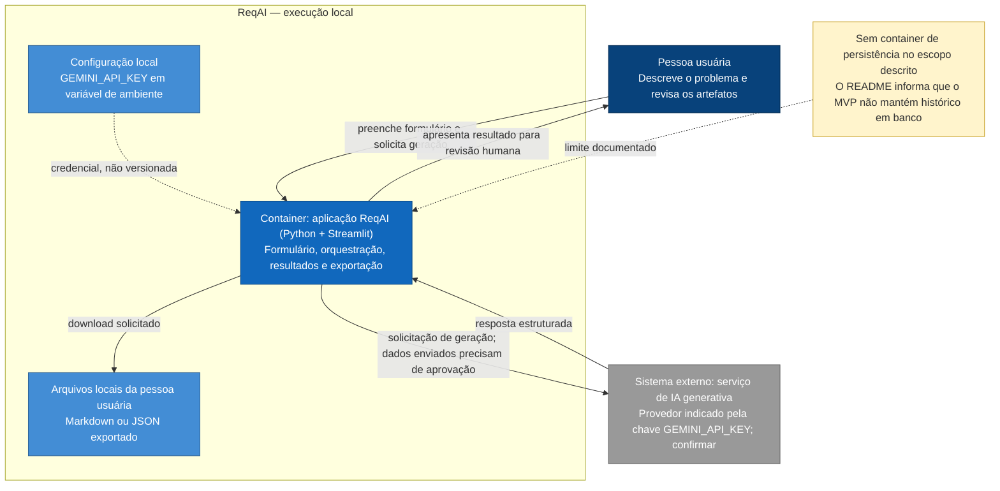

# ReqAI - Assistente Inteligente de Engenharia de Requisitos e Análise de Riscos

O **ReqAI** é uma ferramenta projetada para automatizar e padronizar as etapas iniciais de levantamento de requisitos e análise de riscos em projetos de software utilizando Inteligência Artificial Generativa. O projeto foi concebido como Trabalho de Conclusão de Curso (TCC) para a pós-graduação em Engenharia de Software.

---

## 📋 Visão Geral

Na fase de concepção (*Discovery*) de software, a documentação inicial consome tempo considerável e muitas vezes carece de padronização. O **ReqAI** atua como uma ferramenta de apoio (*Developer/Analyst Tooling*), recebendo descrições textuais brutas de problemas de negócio e transformando-as em artefatos formais e estruturados de engenharia de software.

---

## 🎯 Escopo do Sistema

### O que o sistema faz:
- **Processamento de Linguagem Natural:** Recebe uma descrição textual bruta de um problema de negócio ou ideia de software.
- **Geração de Artefatos Estruturados:**
  - **Histórias de Usuário:** Formato ágil (*Como... Quero... Para...*) com critérios de aceitação.
  - **Requisitos Não Funcionais:** Categorizados (desempenho, segurança, usabilidade, etc.).
  - **Matriz de Riscos Preliminar:** Riscos com probabilidade, impacto e estratégias de mitigação.
- **Exportação:** Permite a visualização e exportação dos dados gerados em formatos estruturados (Markdown / JSON).

### O que o sistema NÃO faz:
- Não é um sistema de gestão de projetos (não possui Kanban, sprints ou gestão de tarefas).
- Não substitui a validação técnica e de negócio realizada por profissionais humanos.
- Não realiza persistência complexa de dados em banco de dados na versão MVP.

---

## 👤 Limites e Responsabilidades

* **Limites do Sistema:** Focado na geração pontual e estruturada de artefatos a partir do envio de um formulário inicial.
* **Responsabilidade do Sistema:** Processar o texto de entrada e retornar dados estruturados via técnicas avançadas de *prompting* e *Structured Outputs*.
* **Responsabilidade do Usuário:** Fornecer um contexto inicial claro, revisar, validar e adaptar os requisitos e riscos gerados para uso real no projeto.

---

## 🔎 Discovery — Descrição do Sistema

O ReqAI é concebido como uma ferramenta de apoio à fase inicial (*Discovery*) de projetos de software. A pessoa usuária informa, por um formulário, uma descrição textual de um problema de negócio ou ideia de produto. O sistema pretende transformar esse contexto em histórias de usuário com critérios de aceitação, requisitos não funcionais categorizados e uma matriz preliminar de riscos, para revisão humana e exportação em Markdown ou JSON.

**Escopo:** geração pontual de artefatos iniciais de requisitos e riscos. O MVP descrito não inclui gestão de tarefas/sprints, autenticação, múltiplos perfis, histórico persistente em banco ou chat multi-turno. Os resultados são apoio à análise; a validação e adaptação para uso real são responsabilidade de profissionais humanos.

**Nível da visão:** produto e jornada de usuário, mais uma visão conceitual do limite do sistema e da integração externa. A aplicação é descrita como local, em Python/Streamlit, com um serviço externo de IA generativa. `GEMINI_API_KEY` sugere Gemini, mas não confirma o provedor nem seu modelo. O provedor, tratamento de dados, público, metas de qualidade e políticas de retenção permanecem lacunas.

**Restrições conhecidas:** execução local sem infraestrutura complexa de nuvem ou containers para o MVP; esforço de TCC estimado no README em aproximadamente dois meses e 32 horas. **Estado de implementação:** o `app.py` atual contém somente a tela inicial Streamlit; a integração com IA e a jornada de geração descritas são escopo pretendido, não comportamento implementado no código atual.

A descrição consolidada, com fatos, hipóteses e lacunas separados, está em [discovery/descricao-sistema.md](discovery/descricao-sistema.md).
Para o histórico de inferências, ajustes de documentação e decisões que ainda faltam para um handoff de implementação sem suposições, consulte [docs/decisoes/retrospectiva-documentacao-reqai.md](docs/decisoes/retrospectiva-documentacao-reqai.md).

## 📐 Diagramas Mermaid

Os dois blocos Mermaid abaixo são renderizados diretamente nesta página pelo GitHub. Eles representam a visão estrutural do sistema e a jornada crítica de geração; os arquivos `.mmd` correspondentes estão em [diagramas/containers.mmd](diagramas/containers.mmd) e [diagramas/sequencia-geracao.mmd](diagramas/sequencia-geracao.mmd). Os diagramas são conceituais e não significam que os fluxos já estejam implementados.

### Visão estrutural — containers inspirados em C4

Este diagrama mostra a pessoa usuária, o container local ReqAI, a configuração e os arquivos exportados, além do serviço externo de IA. Interface e processamento ficam no mesmo container porque o escopo descreve uma aplicação Python/Streamlit local; a ausência de histórico em banco está marcada como limite do MVP.



### Jornada comportamental — geração, timeout e idempotência conceitual

O diagrama de sequência cobre a jornada crítica de envio do contexto, geração, revisão e exportação, além do caminho de timeout. Se houver timeout, o resultado remoto é tratado como indeterminado e não há repetição automática. A deduplicação ilustrada limita-se à sessão ativa; suporte a idempotência do provedor externo não foi confirmado nem implementado, portanto uma repetição pode gerar nova chamada e custo.

```mermaid
sequenceDiagram
    autonumber
    actor Pessoa as Pessoa usuária
    participant UI as Interface Streamlit
    participant App as Aplicação Python ReqAI
    participant IA as Serviço externo de IA

    Note over Pessoa,IA: Fluxo conceitual; provedor, suporte a chave de idempotência e política de timeout precisam de confirmação.

    Pessoa->>UI: Preenche contexto e solicita geração
    UI->>App: gerar(contexto, chaveIdempotencia)
    App->>App: Validar entrada e consultar chave na sessão ativa

    alt Mesmo pedido já concluído nesta sessão
        App-->>UI: Retornar resultado já associado à chave
        UI-->>Pessoa: Exibir resultado sem nova chamada à IA
    else Mesmo pedido ainda em andamento
        App-->>UI: Informar que a solicitação está em andamento
        UI-->>Pessoa: Evitar envio concorrente duplicado
    else Nova solicitação
        App->>App: Reservar chave e associar contexto
        App->>IA: Solicitar artefatos estruturados

        alt Resposta recebida antes do timeout
            IA-->>App: Resposta estruturada
            App->>App: Validar estrutura e guardar resultado na sessão
            App-->>UI: Resultado validado
            UI-->>Pessoa: Exibir histórias, NFRs e matriz de riscos
            Pessoa->>UI: Revisar e solicitar exportação
            UI-->>Pessoa: Disponibilizar Markdown ou JSON
        else Timeout aguardando o serviço
            Note over App,IA: A chamada pode ter sido processada remotamente mesmo sem resposta; o resultado é desconhecido.
            App-->>UI: Marcar resultado como indeterminado; não sinalizar sucesso
            UI-->>Pessoa: Informar timeout e não repetir automaticamente

            opt Pessoa solicita nova tentativa explícita com a mesma chave e contexto
                Pessoa->>UI: Solicitar nova tentativa
                UI->>App: repetir(chaveIdempotencia, mesmoContexto)
                App->>App: Conferir chave e contexto da sessão
                alt Provedor confirma suporte à idempotência
                    App->>IA: Reenviar com a mesma chave de idempotência
                    IA-->>App: Retornar resultado original ou processar uma vez
                    App->>App: Validar estrutura e guardar resultado na sessão
                    App-->>UI: Resultado validado
                    UI-->>Pessoa: Exibir resultado para revisão
                else Suporte do provedor ausente ou não confirmado
                    App-->>UI: Não prometer deduplicação remota
                    UI-->>Pessoa: Explicar que repetir pode gerar nova chamada e custo
                end
            end
        end
    end

    Note over UI,App: Deduplicação na sessão ativa não sobrevive ao encerramento da sessão; o MVP não define persistência durável.
```

### Decisões e ajustes aplicados ao conteúdo gerado

- Consolidei a interface e o processamento Python em um único container, em vez de inventar serviços separados não indicados pelo escopo local do README.
- Mantive o provedor de IA como sistema externo genérico: a variável `GEMINI_API_KEY` é evidência sugestiva, não confirmação suficiente do provedor ou modelo.
- Indiquei ausência de histórico em banco, sem desenhar um container de persistência não documentado.
- Tratei a chave de idempotência e a deduplicação em sessão como elementos conceituais do diagrama de sequência, não como funcionalidade já implementada. Timeout não prova que o serviço externo deixou de processar a solicitação.
- Preservei a revisão humana e a possível exportação como parte da jornada, e marquei explicitamente que a integração e a geração ainda não existem no `app.py` atual.
- Os diagramas foram gerados com assistência de IA e ajustados contra os fatos e lacunas do README; não foi executada uma chamada a provedor externo de IA durante esta atualização.

---

## 🛠️ Pilha Tecnológica e Integrações

* **Linguagem:** Python 3.x
* **Interface:** Streamlit
* **Inteligência Artificial:** SDK oficial de IA Generativa (com suporte a *Structured Outputs*)
* **Ambiente de Desenvolvimento:** Visual Studio Code
* **Controle de Versão:** Git / GitHub

---

## ⚠️ Restrições e Lacunas (Gaps)

### Restrições:
* **Tempo de Desenvolvimento:** Projetado para execução individual em um período de 2 meses (~32 horas de dedicação total).
* **Infraestrutura:** Aplicação executada localmente, sem necessidade de infraestrutura de nuvem ou *containers* complexos para a versão MVP.

### Lacunas Conhecidas (Work in Progress / Futuras Melhorias):
* **Autenticação:** Não contempla controle de acesso ou múltiplos perfis de usuário.
* **Persistência de Dados:** Ausência de banco de dados para histórico de projetos gerados.
* **Refinamento Iterativo:** A geração é executada em bloco único a partir do prompt inicial, sem suporte a chat multi-turno nesta versão.

---

## 🚀 Como Executar o Projeto Localmente

1. **Clone o repositório:**
   ```bash
   git clone https://github.com/seu-usuario/reqai.git
   cd reqai
   ```

2. **Crie e ative um ambiente virtual:**
   ```bash
   python -m venv venv
   # No Linux/macOS:
   source venv/bin/activate
   # No Windows:
   venv\Scripts\activate
   ```

3. **Instale as dependências:**
   ```bash
   pip install -r requirements.txt
   ```

4. **Configure a chave de API da IA:**
   Crie um arquivo `.env` na raiz do projeto e adicione a sua chave:
   ```env
   GEMINI_API_KEY=sua_chave_aqui
   ```

5. **Execute a aplicação Streamlit:**
   ```bash
   streamlit run app.py
   ```
