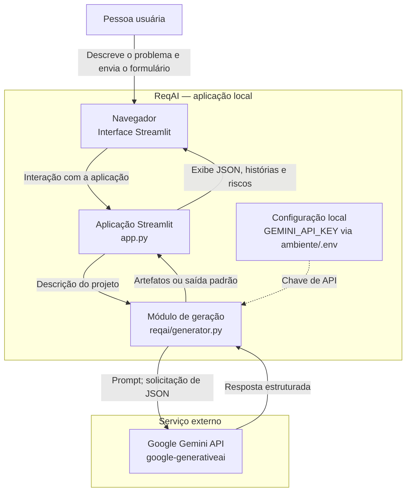

# ReqAI - Assistente Inteligente de Engenharia de Requisitos e Análise de Riscos

O **ReqAI** é uma ferramenta projetada para automatizar e padronizar as etapas iniciais de levantamento de requisitos e análise de riscos em projetos de software utilizando Inteligência Artificial Generativa. O projeto foi concebido como Trabalho de Conclusão de Curso (TCC) para a pós-graduação em Engenharia de Software.

---

## 📋 Visão Geral

Na fase de concepção (*Discovery*) de software, a documentação inicial consome tempo considerável e muitas vezes carece de padronização. O **ReqAI** atua como uma ferramenta de apoio (*Developer/Analyst Tooling*), recebendo descrições textuais brutas de problemas de negócio e transformando-as em artefatos formais e estruturados de engenharia de software.

---

## 🎯 Escopo do Sistema

### O que o sistema faz:
- **Processamento de Linguagem Natural:** Recebe uma descrição textual bruta de um problema de negócio ou ideia de software.
- **Geração de Artefatos Estruturados:**
  - **Histórias de Usuário:** Formato ágil (*Como... Quero... Para...*) com critérios de aceitação.
  - **Requisitos Não Funcionais:** Categorizados (desempenho, segurança, usabilidade, etc.).
  - **Matriz de Riscos Preliminar:** Riscos com probabilidade, impacto e estratégias de mitigação.
- **Exportação:** Permite a visualização e exportação dos dados gerados em formatos estruturados (Markdown / JSON).

### O que o sistema NÃO faz:
- Não é um sistema de gestão de projetos (não possui Kanban, sprints ou gestão de tarefas).
- Não substitui a validação técnica e de negócio realizada por profissionais humanos.
- Não realiza persistência complexa de dados em banco de dados na versão MVP.

---

## 👤 Limites e Responsabilidades

* **Limites do Sistema:** Focado na geração pontual e estruturada de artefatos a partir do envio de um formulário inicial.
* **Responsabilidade do Sistema:** Processar o texto de entrada e retornar dados estruturados via técnicas avançadas de *prompting* e *Structured Outputs*.
* **Responsabilidade do Usuário:** Fornecer um contexto inicial claro, revisar, validar e adaptar os requisitos e riscos gerados para uso real no projeto.

---

## 🛠️ Pilha Tecnológica e Integrações

* **Linguagem:** Python 3.x
* **Interface:** Streamlit
* **Inteligência Artificial:** SDK oficial de IA Generativa (com suporte a *Structured Outputs*)
* **Ambiente de Desenvolvimento:** Visual Studio Code
* **Controle de Versão:** Git / GitHub

---

## ⚠️ Restrições e Lacunas (Gaps)

### Restrições:
* **Tempo de Desenvolvimento:** Projetado para execução individual em um período de 2 meses (~32 horas de dedicação total).
* **Infraestrutura:** Aplicação executada localmente, sem necessidade de infraestrutura de nuvem ou *containers* complexos para a versão MVP.

### Lacunas Conhecidas (Work in Progress / Futuras Melhorias):
* **Autenticação:** Não contempla controle de acesso ou múltiplos perfis de usuário.
* **Persistência de Dados:** Ausência de banco de dados para histórico de projetos gerados.
* **Refinamento Iterativo:** A geração é executada em bloco único a partir do prompt inicial, sem suporte a chat multi-turno nesta versão.

---

## 🧱 Arquitetura de Containers

Diagrama estrutural inspirado em C4 para a versão atual do MVP:



Sem `GEMINI_API_KEY`, o gerador retorna uma saída padrão. Erros durante a chamada ao modelo ou o parsing também acionam essa saída padrão. O MVP não persiste resultados.

## 🔄 Sequência de Geração e Idempotência

O diagrama abaixo descreve o caminho feliz e um fluxo proposto de timeout com idempotência. O registro de idempotência, a consulta de estado e a reconciliação são componentes futuros e **não estão implementados no MVP**.

```mermaid
sequenceDiagram
    autonumber
    actor U as Pessoa usuária
    participant UI as Interface Streamlit
    participant APP as Aplicação ReqAI
    participant IDEM as Registro de idempotência (futuro)
    participant GEN as Módulo de geração
    participant AI as API Gemini

    U->>UI: Envia descrição
    UI->>APP: Solicita geração (chave K)
    APP->>IDEM: Consultar ou reservar K

    alt K já concluída
        IDEM-->>APP: Resultado armazenado
        APP-->>UI: Retorna o mesmo resultado
        UI-->>U: Exibe artefatos sem nova geração
    else K nova
        IDEM-->>APP: Reserva K como em andamento
        APP->>GEN: Gerar artefatos
        GEN->>AI: Envia prompt

        alt Resposta recebida dentro do prazo
            AI-->>GEN: JSON estruturado
            GEN-->>APP: Resultado validado
            APP->>IDEM: Armazena resultado e marca K como concluída
            APP-->>UI: Retorna resultado
            UI-->>U: Exibe histórias, requisitos e riscos
        else Timeout ou resultado remoto incerto
            AI-xGEN: Resposta não recebida a tempo
            GEN-->>APP: Informa timeout; resultado remoto incerto
            APP->>IDEM: Marca K como desconhecida ou pendente de reconciliação
            APP-->>UI: Informa que o resultado ainda não está disponível
            UI-->>U: Orienta consultar novamente usando a mesma chave K

            U->>UI: Tenta novamente
            UI->>APP: Consulta status usando K
            APP->>IDEM: Consulta K
            IDEM-->>APP: Pendente ou desconhecida
            APP-->>UI: Retorna o estado sem iniciar nova geração
            UI-->>U: Exibe o estado e orienta aguardar ou reconciliar
        end
    end
```

Uma chave de idempotência e um registro de estado podem impedir que uma repetição inicie automaticamente outra geração. Se o provedor não oferecer idempotência ou consulta do estado da solicitação, um timeout pode deixar incerto se a chamada foi processada; portanto, não se deve prometer execução “exatamente uma vez” sem suporte do provedor.

## ✅ Checklist de Revisão para Pull Request

### Funcionalidade e comportamento
- [ ] O fluxo de entrada e geração atende ao escopo do PR.
- [ ] Entrada vazia ou composta apenas por espaços é tratada como esperado.
- [ ] A resposta contém e exibe corretamente histórias, requisitos não funcionais e matriz de riscos.
- [ ] Falhas e respostas inválidas do provedor são tratadas de forma explícita e compreensível para a pessoa usuária.
- [ ] Se houver timeout ou repetição, o comportamento de idempotência está documentado e testado.

### Integração e configuração
- [ ] A chave da API não está no código, nos logs ou em arquivos versionados.
- [ ] Alterações na configuração e nas dependências estão refletidas nos arquivos apropriados.
- [ ] Chamadas ao provedor têm limites de tempo e tratamento de erros compatíveis com o fluxo.
- [ ] O contrato esperado para a resposta JSON está validado.

### Qualidade e testes
- [ ] Há testes para o caminho feliz, entradas-limite e falhas relevantes.
- [ ] Testes de integração com o provedor não dependem de credenciais reais, salvo quando explicitamente configurados.
- [ ] A suíte relevante passa localmente.
- [ ] Alterações mantêm compatibilidade com o comportamento existente ou descrevem claramente qualquer mudança.

### Revisão e entrega
- [ ] A documentação de execução ou configuração foi atualizada, se necessário.
- [ ] O diff não inclui segredos, arquivos temporários ou mudanças fora do escopo.
- [ ] O PR descreve o problema, a solução, como validar e limitações conhecidas.
- [ ] A interface apresenta mensagens claras para carregamento, sucesso e falha.

---

## 🚀 Como Executar o Projeto Localmente

1. **Clone o repositório:**
   ```bash
   git clone https://github.com/seu-usuario/reqai.git
   cd reqai
   ```

2. **Crie e ative um ambiente virtual:**
   ```bash
   python -m venv venv
   # No Linux/macOS:
   source venv/bin/activate
   # No Windows:
   venv\Scripts\activate
   ```

3. **Instale as dependências:**
   ```bash
   pip install -r requirements.txt
   ```

4. **Configure a chave de API da IA:**
   Crie um arquivo `.env` na raiz do projeto e adicione a sua chave:
   ```env
   GEMINI_API_KEY=sua_chave_aqui
   ```

5. **Execute a aplicação Streamlit:**
   ```bash
   streamlit run app.py
   ```
